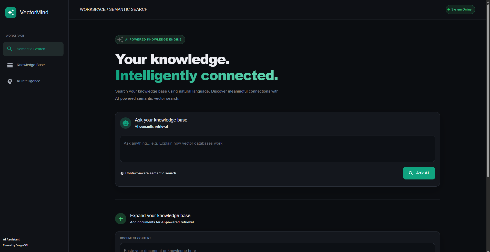

# 🚀 AI-Powered Vector Search Application

An AI-powered semantic search application built using **FastAPI, React.js, Sentence Transformers, PostgreSQL, and pgvector**.

This application allows users to store documents, generate vector embeddings, and perform semantic searches based on contextual meaning rather than exact keyword matching.

---

## ✨ Features

- 🔍 Semantic Search using vector embeddings
- 🤖 AI Embeddings using Sentence Transformers
- 🗄️ PostgreSQL database with pgvector extension
- 📄 Insert and retrieve documents
- 🎯 Similarity-based search using cosine distance
- ⚡ FastAPI REST API backend
- ⚛️ React.js interactive frontend
- 🐳 Docker-based PostgreSQL setup

---

## 🛠️ Tech Stack

| Technology | Purpose |
|---|---|
| Python | Backend |
| FastAPI | REST API |
| React.js | Frontend |
| Sentence Transformers | Embedding Generation |
| all-MiniLM-L6-v2 | Embedding Model |
| PostgreSQL | Database |
| pgvector | Vector Storage and Search |
| Docker | Database Containerization |

---

## 📸 Application Screenshots

### 🏠 Home Page



### 📝 Add Document


### 🔍 Semantic Search Results


---

## 🏗️ Project Architecture

```text
             User
               |
               v
        React.js Frontend
               |
               | HTTP Requests
               v
          FastAPI Backend
               |
               v
       Sentence Transformers
          (Text Embeddings)
               |
               v
        PostgreSQL + pgvector
               |
               v
          Vector Search
          (Cosine Distance)
               |
               v
         Search Results
               |
               v
        React.js Frontend
```

---

## 📂 Project Structure

```text
AI-Vector-Search/
│
├── backend/
│   ├── main.py
│   ├── db.py
│   ├── requirements.txt
│   └── .env
│
├── frontend/
│   ├── src/
│   ├── public/
│   ├── package.json
│   └── ...
│
├── screenshots/
│   ├── home-page.png
│   ├── add-document.png
│   └── search-results.png
│
├── docker-compose.yml
├── .gitignore
└── README.md
```

---

## ⚙️ Installation and Setup

### 1. Clone Repository

```bash
git clone https://github.com/YOUR_USERNAME/AI-Vector-Search.git

cd AI-Vector-Search
```

### 2. Start PostgreSQL with pgvector using Docker

Make sure Docker is installed and running.

```bash
docker run -d \
  --name vector-db \
  -e POSTGRES_USER=postgres \
  -e POSTGRES_PASSWORD=your_password \
  -e POSTGRES_DB=vector_db \
  -p 5432:5432 \
  pgvector/pgvector:pg16
```

### 3. Enable pgvector Extension

Connect to your PostgreSQL database and execute:

```sql
CREATE EXTENSION IF NOT EXISTS vector;
```

### 4. Create Documents Table

```sql
CREATE TABLE documents (
    id SERIAL PRIMARY KEY,
    content TEXT NOT NULL,
    category VARCHAR(255) DEFAULT 'General',
    embedding VECTOR(384)
);
```

**Note:** The embedding dimension is 384 because we use the `all-MiniLM-L6-v2` model.

### 5. Configure Environment Variables

Create a `.env` file inside the backend folder.

```env
DB_HOST=localhost
DB_PORT=5432
DB_NAME=vector_db
DB_USER=postgres
DB_PASSWORD=your_password
```

Update the variable names according to your `db.py` configuration.

**Important:** Never upload your actual `.env` file to GitHub.

### 6. Setup FastAPI Backend

Navigate to the backend directory:

```bash
cd backend
```

Create a virtual environment:

```bash
python -m venv venv
```

Activate virtual environment.

**Windows:**

```bash
venv\Scripts\activate
```

**Linux / macOS:**

```bash
source venv/bin/activate
```

Install dependencies:

```bash
pip install -r requirements.txt
```

Run FastAPI server:

```bash
uvicorn main:app --reload
```

Backend URL:

http://localhost:8000

Swagger API Documentation:

http://localhost:8000/docs

### 7. Setup React Frontend

Open another terminal and navigate to frontend:

```bash
cd frontend
```

Install dependencies:

```bash
npm install
```

Start React development server:

```bash
npm run dev
```

Frontend URL:

http://localhost:5173

---

## 🔌 API Endpoints

Base URL: `http://localhost:8000`

| Method | Endpoint | Description |
|---|---|---|
| GET | `/api/health` | Check API status |
| POST | `/api/documents` | Insert a document |
| GET | `/api/documents` | Get all documents |
| POST | `/api/search` | Perform semantic search |

### 1. Health Check

**GET** `/api/health`

Response:

```json
{
  "status": "success",
  "message": "Vector Search API is running"
}
```

### 2. Insert Document

**POST** `/api/documents`

Request:

```json
{
  "content": "Artificial Intelligence is transforming the world.",
  "category": "Technology"
}
```

### 3. Get All Documents

**GET** `/api/documents`

Returns all stored documents with their IDs and categories.

### 4. Semantic Search

**POST** `/api/search`

Request:

```json
{
  "query": "How is AI changing technology?",
  "limit": 5
}
```

Example Response:

```json
{
  "status": "success",
  "query": "How is AI changing technology?",
  "total_results": 1,
  "results": [
    {
      "id": 1,
      "content": "Artificial Intelligence is transforming the world.",
      "category": "Technology",
      "similarity": 85.25,
      "distance": 0.1475
    }
  ]
}
```

*Example similarity and distance values are illustrative.*

---

## 🧠 How Semantic Search Works

1. User enters a document through the React frontend.
2. FastAPI receives the document.
3. Sentence Transformers converts the document into a 384-dimensional vector embedding.
4. The generated embedding is stored in PostgreSQL using pgvector.
5. User enters a search query.
6. The query is converted into a vector embedding using the same model.
7. pgvector calculates cosine distance between the query embedding and stored embeddings.
8. Relevant documents are returned based on similarity.

### Cosine Distance Query

The application uses the pgvector cosine distance operator:

```sql
SELECT
    id,
    content,
    category,
    embedding <=> query_embedding AS distance
FROM documents
ORDER BY embedding <=> query_embedding
LIMIT 5;
```

### Similarity Calculation

```python
similarity = (1 - distance) * 100
```

---

## 🔒 Environment Variables

For security reasons, `.env` files are excluded from GitHub.

Use a `.env.example` file to show the required configuration without exposing actual credentials.

---

## 🚀 Future Enhancements

- 📄 PDF and DOCX document upload
- ✂️ Document chunking for large files
- 🏷️ Category-based filtering
- 🔐 User authentication
- 📑 Search pagination
- 🎯 Advanced search ranking
- ☁️ Cloud deployment
- 🐳 Full application Docker Compose setup

---

## 👨‍💻 Author

**Your Name**

GitHub: https://github.com/hemangdevaliya

---

## ⭐ Support

If you find this project useful, please consider giving it a ⭐ on GitHub!
